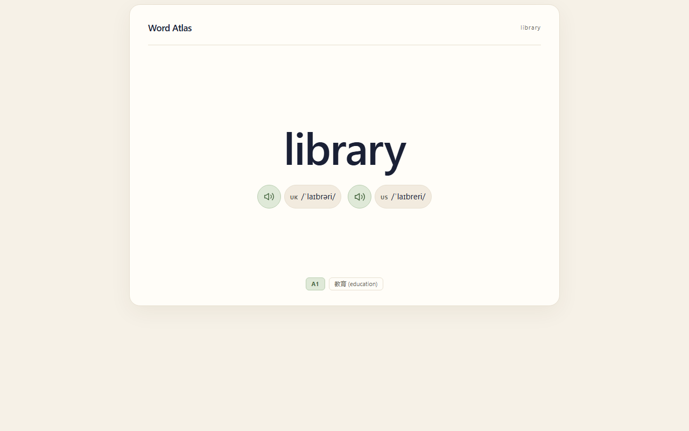
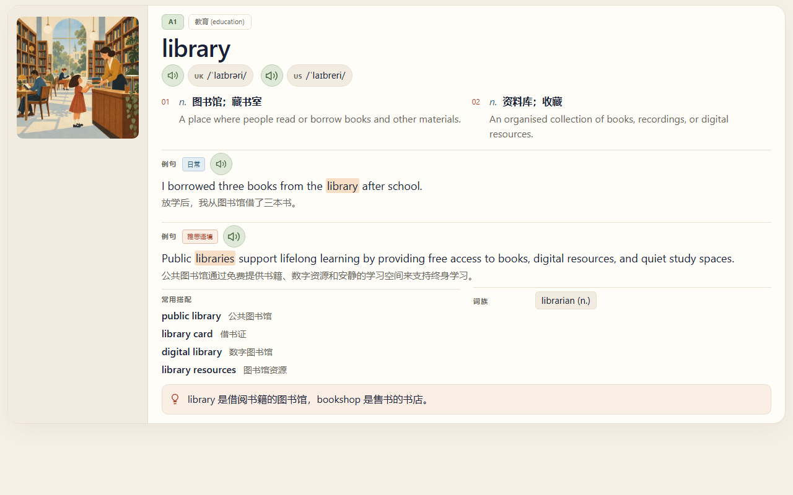
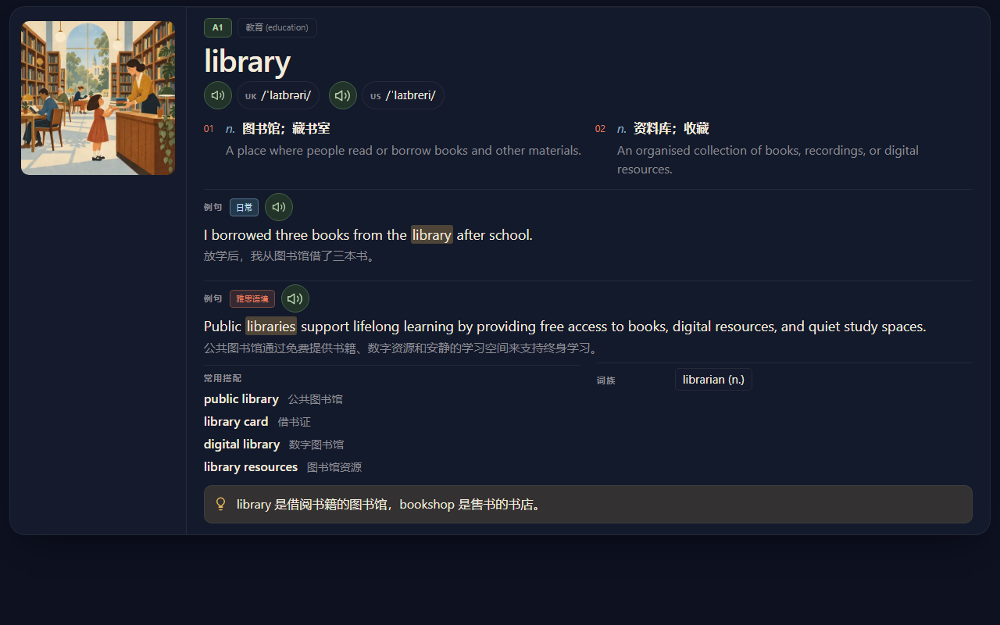
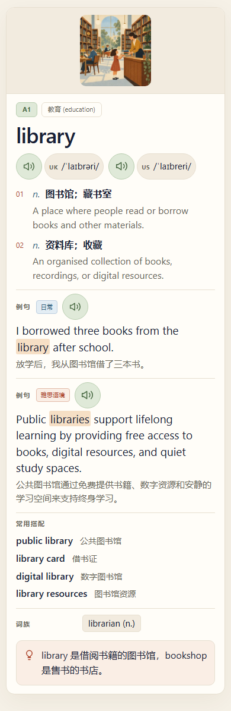

# Word Atlas Anki


把 [Word Atlas](https://github.com/designfuchen/word-atlas) 的单词、释义、插画和录音，整理成一套**完全离线、可增量更新**的 Anki 牌组。

非官方适配。牌组内容 CC BY 4.0，转换代码 MIT。

**[下载最新版](https://github.com/Misakamoe/WordAtlas-Anki/releases)**

## 预览

以下截图由实际牌组渲染（词条 `library`）

| 正面：回忆词义 | 背面：完整词条 |
| :---: | :---: |
|  |  |
| 单词、英美音标、发音按钮、等级与话题 | 插画、全部释义、双语例句、搭配、词族与提示 |

<p align="center">
  
  
</p>
<p align="center"><sub>深色模式（左）与手机竖屏布局（右）。实际字号和间距会随 Anki 客户端与设备变化。</sub></p>

## 这套牌组有什么

- **7,298 个词，按 CEFR 分为六级**：A1 785、A2 1,039、B1 1,465、B2 2,127、C1 1,608、C2 274；覆盖 19 个话题。
- **一词一条笔记、一张正向卡**：正面回忆，背面展开；不包含作者的复习记录或学习进度。
- **全离线媒体**：每个词都配有插画、英音、美音和第一条例句录音；1,011 个词还有第二条例句录音。图片和音频随牌组打包，不依赖网络。
- **英美双音标**：UK / US 始终分列显示；缺失的一侧会明确标注，不会复制另一侧冒充。
- **完整词条**：全部词性与释义、英文释义、1–2 条双语例句、关键词高亮、常用搭配、词族、近义、反义、记忆提示和用法提醒。
- **跟随 Anki 明暗模式**：浅色为暖纸配色，深色为星光配色；A1–A2 绿色、B1–B2 蓝色、C1–C2 红色区分难度。
- **可持续更新**：固定 GUID 与固定笔记类型，导入新版不会重建卡片；已有复习进度和挂起状态不会被强制覆盖。维护者每天检查上游，只有有效变化才发布。
- **可核对**：每次发布附 `release-notes.md`、`manifest.json` 和 `SHA256SUMS`，包含逐词变化、媒体摘要与校验值。

## 下载与导入

1. 打开 [Releases](https://github.com/Misakamoe/WordAtlas-Anki/releases)，下载当前版本**全部** `.apkg` 文件。如果一个版本被拆成多个包，它们不是分卷压缩：每个都能独立导入，但请全部导入，才会得到完整词库。
2. 先备份 Anki 集合。
3. 在 Anki 中选择 **文件 → 导入**，选中 `.apkg`；有多个包时重复导入。
4. 导入后打开 `Word Atlas`，其下会有 `A1`–`C2` 六个子牌组。

### 建议的音频设置

- 在牌组选项中开启**自动播放**：正面英音只自动播放一次；背面自动播放英音单词和第一条例句。
- 开启**显示重播按钮**，并在反面重播时选择跳过正面音频。
- 美音和第二条例句只在手动点击时播放。第二条例句是另一句话，不是第一句的另一种口音。
- 模板不会修改你的 FSRS、学习步长或牌组预设。

### 更新已有牌组

直接导入新版 `.apkg`，**不要先删除旧牌组**。固定的笔记身份会让 Anki 更新已有笔记，复习进度和挂起状态不会被强制覆盖。

- 升级前先备份集合和媒体。
- 如果你在本地修改过源字段，较新的本地编辑可能阻止默认更新。需要强制采用词库版本时，备份后选择“始终更新笔记”；这会覆盖你对相应字段的修改。
- Anki 26.9.3 后端在更新笔记时会替换标签，自定义标签可能被移除；其他客户端或版本的行为可能不同。请先备份重要标签。
- 上游删除的词不会自动从旧牌组删卡。查看发布说明或 `changes.json` 后，再决定是否保留。
- 媒体使用新的内容寻址文件名。清理旧媒体前先备份，并使用 Anki 的“检查媒体”，不要按文件日期盲删。

## 牌组结构

| 子牌组 | 词数 |
| --- | ---: |
| A1 | 785 |
| A2 | 1,039 |
| B1 | 1,465 |
| B2 | 2,127 |
| C1 | 1,608 |
| C2 | 274 |
| **合计** | **7,298** |

词数对应当前上游快照，后续版本可能随上游增删而变化。

## 兼容性与当前状态

- 当前按**预发布**渠道维护。稳定版需要桌面、Android、iOS 三端的实机音频与升级验收，未全部完成前不会标记为 stable。
- 已在 Anki 26.9.3 后端验证导入/导出、模板渲染和媒体完整性；不同客户端和版本仍可能存在实机差异。
- 牌组使用 Anki 原生模板、CSS、媒体和 `.apkg` 格式，不修改你的全局学习设置。
- 不承诺 AnkiWeb 兼容；跨设备使用时，请等导入和同步完成后再离线学习。
- 仅保证本仓库版本之间的升级契约，不迁移任意旧 CSV 牌组或其他来源的牌组。

## 来源与许可

- 词库、插画和成品录音来自 [Word Atlas contributors](https://github.com/designfuchen/word-atlas)，以 [CC BY 4.0](https://creativecommons.org/licenses/by/4.0/) 授权。
- 本仓库的转换代码使用 [MIT](LICENSE)。
- 随包保留的 Fraunces 字体为 OFL 1.1，Lucide 图标为 ISC；完整许可文本见 [licenses](licenses) 和牌组媒体。
- 本项目是**非官方适配**，与上游 Word Atlas 及雅思官方没有隶属或背书关系，也不是官方雅思词表。
- 上游内容由 AI 生成，未经逐条人工审校，请按现状使用。录音授权不包含声音模型或声音身份，不代表声音提供方背书。
- 本仓库只做 Anki 排版、英美双音标、离线媒体命名和播放策略；没有重新生成文本、插画或录音。

## 从源码构建

<details>
<summary>展开构建步骤</summary>

需要 Python 3.12、Git 和 ffmpeg。以下命令在仓库根目录的 PowerShell 中运行。

```powershell
python -m venv .venv
.venv\Scripts\Activate.ps1
python -m pip install --require-hashes -r requirements.lock
python -m pip install --no-deps --no-build-isolation -e .

# 拉取上游快照和媒体，再读取本次使用的提交号
python -m word_atlas_anki fetch --upstream .cache/upstream --media
$sha = git -C .cache/upstream rev-parse HEAD
python -m word_atlas_anki build --upstream .cache/upstream --upstream-sha $sha --out dist
python -m word_atlas_anki verify --out dist
```

`fetch --media` 会拉取全部插图与音频，体积较大。只想生成小样时，可以给 `fetch` 和 `build` 都加上相同的 `--sample 50`。

安装测试浏览器并运行测试：

```powershell
python -m playwright install --only-shell chromium
python -m pytest
```

</details>
