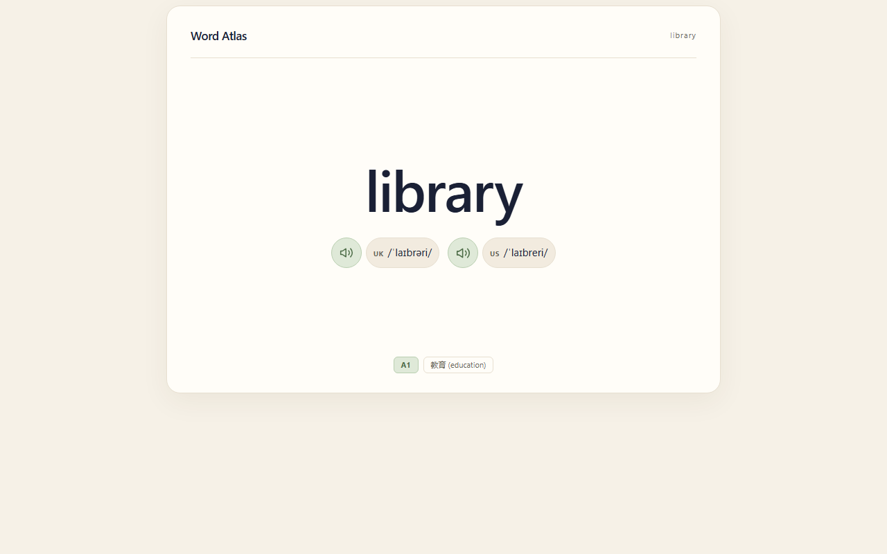
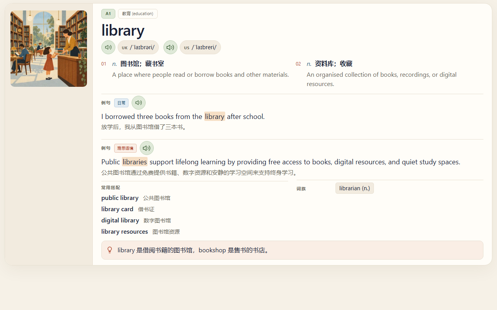
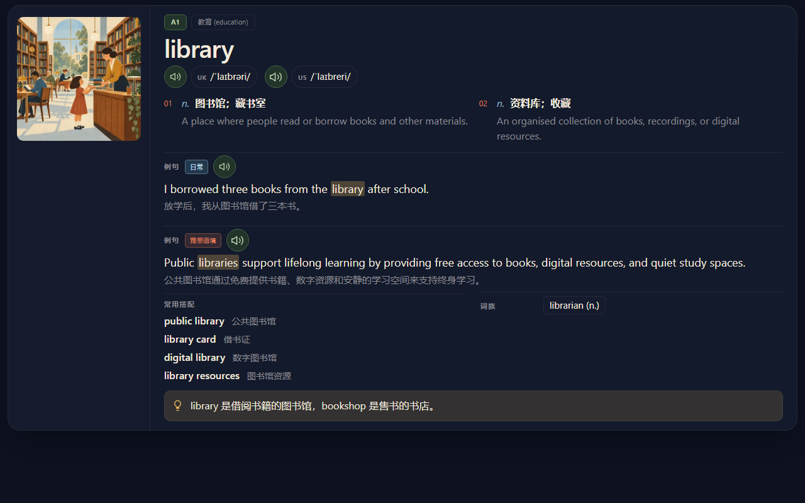
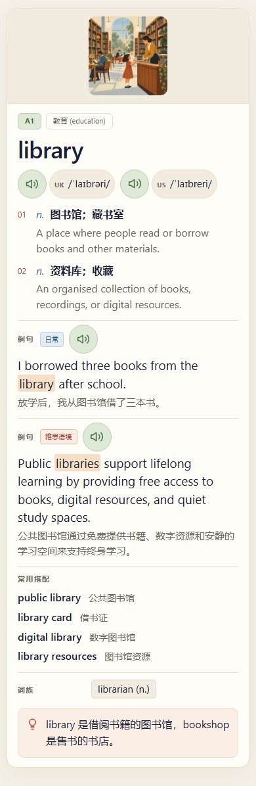

# Word Atlas Anki


把 [Word Atlas](https://github.com/designfuchen/word-atlas) 的单词、释义、插画和录音，整理成一套**完全离线、可增量更新**的 Anki 牌组。

非官方适配。内容 CC BY 4.0，代码 MIT。

**[下载最新版](https://github.com/Misakamoe/WordAtlas-Anki/releases)**

## 预览

| 正面 | 背面 |
| :---: | :---: |
|  |  |

<p align="center">
  
  
</p>
<p align="center"><sub>深色模式（左）与手机布局（右），实际效果随客户端和设备略有差异。</sub></p>

## 内容

- **7,298 个词，按 CEFR 分六级**：A1 785、A2 1,039、B1 1,465、B2 2,127、C1 1,608、C2 274，覆盖 19 个话题。
- **一词一卡**：正面回忆词义，背面展开全部词性、释义、1–2 条双语例句、搭配、词族、近义反义和用法提示。
- **全离线媒体**：插画、英音、美音和例句录音随包提供；1,011 个词还有第二条例句录音。
- **英美双音标**：UK / US 分列显示，缺失侧明确标注，不复制另一侧冒充。
- **明暗主题**：跟随 Anki 自动切换；A1–A2 绿、B1–B2 蓝、C1–C2 红区分难度。
- **可增量更新**：固定笔记身份，导入新版不重建卡片，复习进度和挂起状态不会被强制覆盖。

## 导入

1. 从 [Releases](https://github.com/Misakamoe/WordAtlas-Anki/releases) 下载当前版本**全部** `.apkg`。如有多个包请全部导入。
2. 先备份 Anki 集合。
3. 在 Anki 中选择 **文件 → 导入**。
4. 打开 `Word Atlas`，其下为 `A1`–`C2` 六个子牌组。

## 推荐设置

- 开启**自动播放**：正面播放英音一次，背面播放英音和第一条例句。
- 开启**显示重播按钮**，反面重播时跳过正面音频。
- 美音和第二条例句只在手动点击时播放。第二条例句是另一句话，不是第一句的另一种口音。
- **移动端建议在设置中开启新 UI（新版学习界面）**。
- 模板不会修改你的 FSRS、学习步长或牌组预设。

## 更新

直接导入新版 `.apkg`，**不必先删除旧牌组**。固定的笔记身份会让 Anki 更新已有笔记。

- 升级前备份集合和媒体。布局变化随笔记类型样式更新；导入后完成同步，若仍显示旧样式，先确认样式已更新。
- 需要强制采用词库版本时，可备份后选择“始终更新笔记”，这会覆盖你对相应字段的修改。
- 更新笔记可能替换标签，自定义标签请先备份。
- 上游删除的词不会自动删卡。媒体使用内容寻址文件名，清理旧媒体前先备份并使用“检查媒体”。

## 兼容性

- 当前为**预发布**渠道；稳定版需要桌面、Android、iOS 三端实机验收完成。
- 已在 Anki 26.9.3 后端验证导入/导出、模板渲染和媒体完整性，不同客户端仍可能有实机差异。
- 不承诺 AnkiWeb 兼容；跨设备使用时请等导入和同步完成后再离线学习。
- 仅保证本仓库版本之间的升级，不迁移其他来源或旧 CSV 牌组。

## 来源与许可

- 词库、插画和成品录音来自 [Word Atlas contributors](https://github.com/designfuchen/word-atlas)，以 [CC BY 4.0](https://creativecommons.org/licenses/by/4.0/) 授权；转换代码使用 [MIT](LICENSE)。
- 本项目是非官方适配，与上游及雅思官方没有隶属或背书关系，也不是官方雅思词表。
- 上游内容由 AI 生成，未经逐条人工审校；录音授权不包含声音模型或声音身份。
- 本仓库只做 Anki 排版、英美双音标、离线媒体命名和播放策略，没有重新生成文本、插画或录音。
- 完整许可文本见 [licenses](licenses) 和牌组媒体。

## 构建

<details>
<summary>展开开发者说明</summary>

**检查与发布**：[CI and Release](.github/workflows/release.yml) 统一执行基础测试，发布依赖其通过。

- **PR / 非主分支**：只验证，不发布。
- **主分支推送、手动或约每三天**：检查上游，有输入变化才全量构建、验收并发布。
- **仅 README/预览文档变化**：无待发布输入时跳过重测试。
- **清理**：旧 Actions 记录随主分支检查删除，不影响 Releases。

**本地小样**（Linux/WSL，需 Python 3.12、Git、ffmpeg）：

```bash
python3.12 -m venv .venv && source .venv/bin/activate
python -m pip install --require-hashes -r requirements.lock
python -m pip install --no-deps --no-build-isolation -e .

python -m word_atlas_anki fetch --upstream .cache/upstream --media --sample 12
sha=$(git -C .cache/upstream rev-parse HEAD)
python -m word_atlas_anki build --upstream .cache/upstream --upstream-sha "$sha" --out dist/sample --sample 12
python -m word_atlas_anki verify --out dist/sample --native
```

`fetch` 与 `build` 的样本数须一致，输出目录须为空；小样只用于本地调试，不要用于更新日常牌组。

测试需另装 Node.js 24 与 Playwright Chromium，命令见 [CI and Release](.github/workflows/release.yml)。本地会生成 `changes.json` 和 `release-notes.md` 供验收，但公开 Release 只上传 `.apkg`、`manifest.json` 和 `SHA256SUMS`。

</details>
